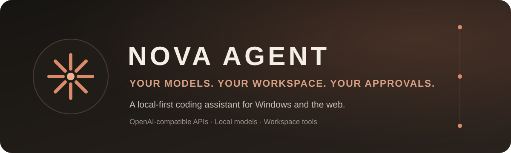
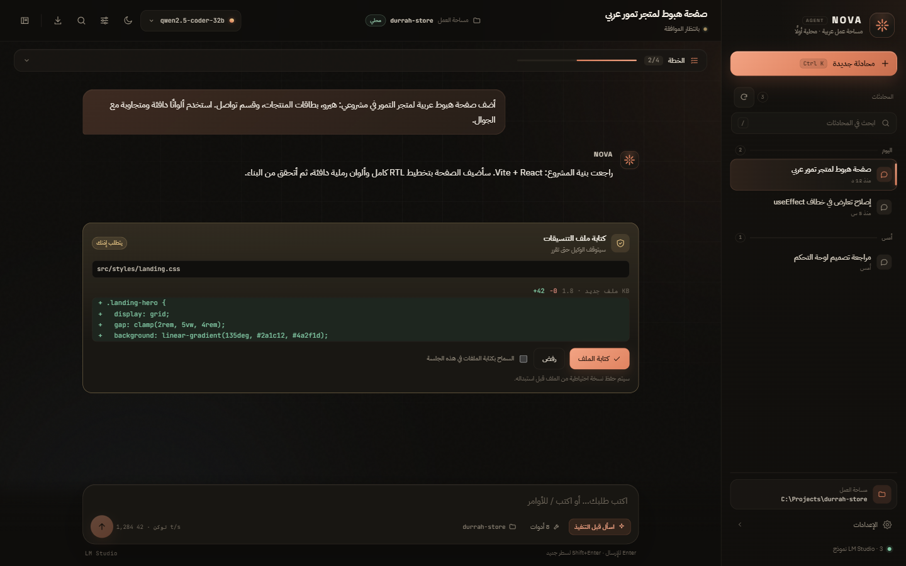
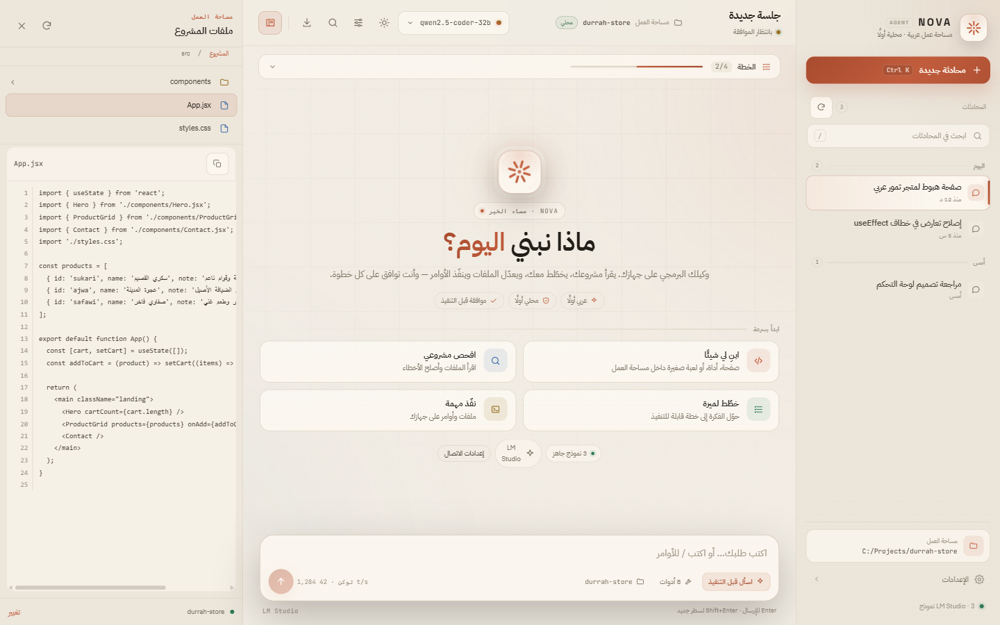
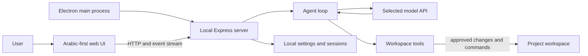

<div align="center">
  

  <p><strong>وكيل برمجة عربي، محلي أولًا، وينفّذ بموافقتك.</strong></p>
  <p><strong>An Arabic-first, local-first coding agent that acts with your approval.</strong></p>

  <p>
    <a href="#ليش-nova">ليش NOVA؟</a> ·
    <a href="#البدء-السريع">البدء السريع</a> ·
    <a href="#why-nova">Why NOVA</a> ·
    <a href="#quick-start">Quick start</a> ·
    <a href="https://king-919.github.io/NOVA-AGENT-Website/">تنزيل / Download</a>
  </p>

  <p>
    <a href="https://github.com/KING-919/NOVA-AGENT-Website/actions/workflows/pages.yml"></a>
    <a href="https://github.com/KING-919/NOVA-AGENT/actions/workflows/release.yml"></a>
    <a href="https://github.com/KING-919/NOVA-AGENT/releases"></a>
    <a href="https://github.com/KING-919/NOVA-AGENT/stargazers"></a>
    <a href="#license"></a>
  </p>
</div>

NOVA Agent is a desktop coding agent for Windows that reads your project, plans with you, and asks before it changes anything. The interface is Arabic-first, the workspace stays on your machine, and you bring the model provider you already use.

> NOVA is an independent project. It does not include or bundle a model or an API subscription. You provide the model endpoint and, when required, its key.

## ليش NOVA؟

معظم أدوات البرمجة بالذكاء الاصطناعي تفترض ثلاثة أشياء: أنك تعمل بالإنجليزية، وأن مشروعك يمكن أن يُرفع إلى سحابتها، وأن الوكيل يجب أن ينفّذ أولًا ويسأل لاحقًا. NOVA مبني على العكس.

- **عربي أولًا، بلا ترجمة حرفية.** واجهة RTL كاملة، أوامر عربية، ونصوص مكتوبة للمطور العربي. الإنجليزية متاحة، لكنها ليست الافتراض.
- **محلي أولًا، بلا حساب.** يقرأ NOVA ملفات مشروعك من جهازك، ويحفظ الإعدادات والجلسات محليًا. لا نرفع مشروعك إلى خوادمنا ولا نطلب تسجيلًا.
- **موافقة أولًا، بلا صندوق أسود.** خطة ظاهرة قبل التنفيذ، ومعاينة فرق قبل الكتابة، وطلب موافقة لكل أمر. أوقف أي خطوة وقتما تريد.
- **مزوّدك ونموذجك، بلا احتكار.** OpenAI، OpenRouter، Gemini، Groq، Ollama، LM Studio، FreeLLMAPI، أو أي API متوافق مع OpenAI. المفاتيح تبقى في إعداداتك المحلية.
- **مساحة عمل كاملة، لا فقاعة دردشة.** مستكشف ملفات، معاينة كود، أدوات مشروع، جلسات، قوالب جاهزة، لوحة أوامر، وتصدير Markdown — في نافذة واحدة.
- **بنية واضحة، بلا طبقة سحابية إجبارية.** خادم Express محلي + واجهة ويب + غلاف Electron. لا خدمة خلفية إضافية بينك وبين مزوّدك، والكود متاح على GitHub للمراجعة.

### الفرق باختصار

| | NOVA | وكيل سحابي | إضافة داخل IDE |
|---|---|---|---|
| واجهة عربية أصلية وRTL | ✓ | — | — |
| ملفات المشروع تبقى على جهازك | ✓ | — | ✓ |
| موافقة قبل كل تعديل وأمر | ✓ | جزئي | جزئي |
| اختيار المزوّد والنموذج | ✓ | — | جزئي |
| نموذج محلي دون إنترنت | ✓ | — | جزئي |
| بدون اشتراك إجباري | ✓ | — | جزئي |

«جزئي» تعني أن الميزة متاحة في بعض الحالات أو تحتاج إعدادًا إضافيًا. NOVA مجاني، وتدفع فقط لمزوّد النموذج إن اخترت مزوّدًا مدفوعًا.

## Why NOVA?

A coding agent should not make you choose between your language, your files, and your control. NOVA is built on three defaults:

- **Arabic first.** A full RTL interface, Arabic instructions, and copy written for Arabic-speaking developers — not a machine translation wrapped around an English product.
- **Local first.** Your project is read from your own folder. Settings and sessions stay on your machine. There is no NOVA account and no project server.
- **Approval first.** A visible plan, a diff before a write, and an approval request before a command runs. The agent proposes; you decide.

Then the practical differences follow: eight provider paths, a real workspace beside the conversation, and a small local architecture you can inspect.

> When you choose a hosted provider, the context the agent sends is governed by that provider's policy. Choose a local model such as Ollama or LM Studio if you want to stay offline.

## لقطات من التطبيق

<p align="center">
  
  
</p>
<p align="center"><sub>محادثة عربية مع خطة وموافقة على ملف · مساحة العمل بجانب المحادثة. · An Arabic chat with a plan and a file approval · the workspace beside the conversation.</sub></p>

## What you can do

- Stream a conversation with a selected model and keep separate sessions.
- Ask for a plan, answer clarifying questions, and approve file edits or shell commands before they run.
- Read and edit workspace files, search project text, and preview files read-only.
- Choose a local or hosted provider and configure any compatible custom endpoint.
- Review diffs, keep a full session history, use prompt templates and the `Ctrl+Shift+P` command palette, and export Markdown.
- Work in Arabic RTL or English, with light and dark themes.
- Run the same interface as a Windows desktop app or in the browser from source.

## Quick start

### Windows desktop

1. [Download the latest NOVA installer](https://king-919.github.io/NOVA-AGENT-Website/) and install it.
2. Open **Settings → AI provider** and choose a local model or enter your provider, model ID, and API key.
3. Select a workspace, start a chat, and begin in **Ask** or **Plan** mode. Review each requested edit or command before approving it.

### Run from source

Requirements: Node.js `>=22.12.0` and npm.

```powershell
git clone https://github.com/KING-919/NOVA-AGENT.git
cd NOVA-AGENT
npm ci
npm start
```

Open [http://localhost:3456](http://localhost:3456). To run the Electron window during development, use `npm run desktop`. On Windows, `start.bat` is also available.

### Optional: Docker

Docker runs NOVA's web interface and local agent server; it does not run the Electron desktop window.

```sh
docker compose up --build
```

Then open [http://localhost:3456](http://localhost:3456). The port is bound to loopback on the host. Chat settings are stored in a named Docker volume; the workspace is mounted at `./workspace`. To reach a model on the host, set `LMSTUDIO_BASE_URL` (default: `http://host.docker.internal:1234`) before starting Compose.

## Model providers

Built-in choices include LM Studio, Ollama, OpenAI, OpenRouter, Groq, Google Gemini's OpenAI-compatible endpoint, FreeLLMAPI, and a custom OpenAI-compatible endpoint. Availability, model IDs, tool calling, pricing, and data handling depend on the provider. Keep API keys in NOVA's local settings; never commit them to Git.

## Architecture



The Electron main process starts the local server and hosts the same interface available in a browser. The server streams agent events to the UI. The agent uses provider adapters and workspace tools; file writes and shell commands can require user approval. Settings and sessions stay in the app's local data directory.

## Build a Windows installer

```powershell
npm ci
npm run dist:win
```

The installer is written to `dist/NOVA-Setup-win-x64.exe`. Pushing a version tag such as `v2.1.4` triggers the Windows build and attaches the installer to a GitHub Release. The installer is not code-signed, so Windows may show a publisher warning.

## Security and privacy

NOVA can read and write files and run commands inside the selected workspace. Start in **Ask** or **Plan** mode and inspect approval requests. Enabling access outside the workspace or automatic command execution broadens what the agent can do. When you use a hosted provider, prompts and the project context sent by NOVA are subject to that provider's policies. NOVA does not operate a project server or require an account.

For suspected security issues, follow [SECURITY.md](SECURITY.md) and do not post exploit details in a public issue.

## Contributing

Bug reports and pull requests are welcome. Please read [CONTRIBUTING.md](CONTRIBUTING.md) before opening a pull request.

## License

No license has been selected yet. The repository is publicly viewable, but public visibility alone does not grant permission to reuse or redistribute its code. A license badge will be added when the project owner chooses a license.

---

## البدء السريع

### تطبيق Windows

1. [نزّل أحدث إصدار من NOVA](https://king-919.github.io/NOVA-AGENT-Website/) وثبّته.
2. افتح **الإعدادات ← مزوّد الذكاء الاصطناعي**، ثم اختر نموذجًا محليًا أو أدخل عنوان API ومعرّف النموذج والمفتاح عند الحاجة.
3. اختر مساحة العمل وابدأ بوضع **اسأل** أو **خطّط**. راجع طلبات تعديل الملفات وتشغيل الأوامر قبل الموافقة.

### التشغيل من المصدر

المتطلبات: Node.js إصدار `22.12.0` أو أحدث وnpm.

```powershell
git clone https://github.com/KING-919/NOVA-AGENT.git
cd NOVA-AGENT
npm ci
npm start
```

افتح [http://localhost:3456](http://localhost:3456). لتشغيل نافذة Electron أثناء التطوير استخدم `npm run desktop`، أو `start.bat` على Windows.

### التشغيل الاختياري عبر Docker

يشغّل Docker واجهة الويب وخادم الوكيل؛ ولا يشغّل نافذة Electron.

```sh
docker compose up --build
```

ثم افتح [http://localhost:3456](http://localhost:3456). المنفذ متاح محليًا على الجهاز فقط. تحفظ إعدادات الجلسة في وحدة Docker، وتُربط مساحة العمل بالمجلد `./workspace`. للاتصال بنموذج يعمل على الجهاز المضيف، عيّن `LMSTUDIO_BASE_URL` قبل تشغيل Compose؛ القيمة الافتراضية `http://host.docker.internal:1234`.

## المزايا

- محادثة متدفقة وجلسات مستقلة مع اختيار النموذج.
- تخطيط للمهام وأسئلة توضيحية وموافقة قبل التعديلات والأوامر.
- قراءة الملفات وتحريرها والبحث داخل المشروع ومعاينة قراءة فقط.
- مزوّدات محلية وسحابية وعناوين API مخصصة متوافقة مع OpenAI.
- قوالب جاهزة، سجل جلسات، لوحة أوامر `Ctrl+Shift+P`، وتصدير Markdown.
- واجهة عربية RTL وسمات فاتحة وداكنة وتطبيق Windows.

## المزوّدات

يدعم المشروع LM Studio وOllama وOpenAI وOpenRouter وGroq وواجهة Gemini المتوافقة مع OpenAI وFreeLLMAPI وأي عنوان مخصص متوافق مع OpenAI Chat Completions. تختلف النماذج والأسعار واستدعاء الأدوات وسياسات البيانات بحسب المزوّد. لا ترفع مفاتيح API إلى Git.

## الأمان والخصوصية

يستطيع NOVA قراءة ملفات مساحة العمل وتعديلها وتشغيل أوامر فيها. ابدأ بوضع **اسأل** أو **خطّط** وراجع طلبات الموافقة. تفعيل الوصول خارج مساحة العمل أو التشغيل التلقائي يوسّع صلاحيات الوكيل. عند استخدام مزوّد سحابي، تخضع الرسائل وسياق المشروع المرسل لسياسة ذلك المزوّد.

للمساهمة راجع [CONTRIBUTING.md](CONTRIBUTING.md)، وللإبلاغ عن مشكلة أمنية راجع [SECURITY.md](SECURITY.md). لم يُحدد ترخيص للمشروع بعد؛ ظهور المستودع للعامة لا يمنح تلقائيًا حق إعادة استخدام الكود أو توزيعه.

موقع التنزيل: [nova-agent1.netlify.app](https://nova-agent1.netlify.app) · [نسخة GitHub Pages](https://king-919.github.io/NOVA-AGENT-Website/) · [مستودع الموقع](https://github.com/KING-919/NOVA-AGENT-Website).
